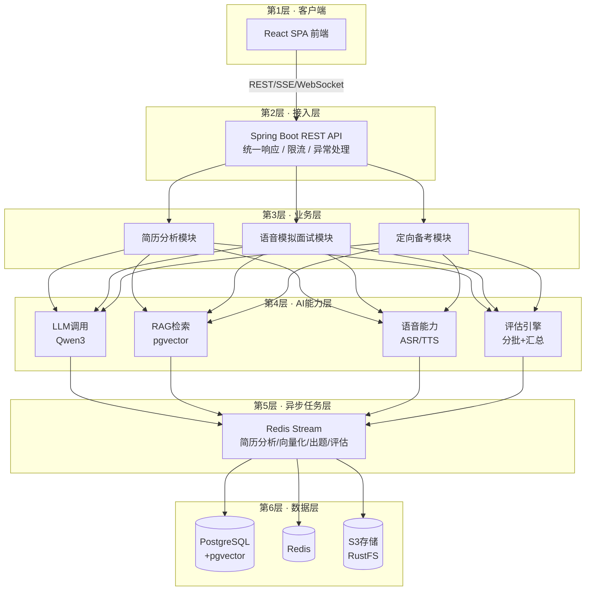

<div align="center">

# AI 面试陪练 —— 让求职者「看懂简历、练好面试、拿下 offer」

**面向 C 端求职者的 AI 面试陪练工具** · 简历分析 · 语音模拟面试 · 定向备考

[](#用户验证)
[](#商业化验证)
[](#成本结构)

</div>


---

## 产品背景

- **市场痛点**：应届生求职竞争激烈，但缺乏系统化的面试练习工具。求职者想"开口练"，但找不到真实的面试环境
- **竞品空白**：53.5% 的应届生用 ChatGPT 练面试，但 ChatGPT 无法提供真实语音对话、结构化评估和定制化出题
- **机会验证**：114 份大四应届生调研显示，73.7% 愿意使用 AI 语音面试产品，77.1% 接受 20 元以下定价

---

## 一、产品定位

> **AI 面试陪练** —— 用大语言模型做简历分析、语音模拟面试、定向备考，帮求职者「看懂简历、练好面试、拿下 offer」。

**核心差异**：不是「AI 面试」本身（ChatGPT 也能做），而是 **真实语音对话 + 结构化评估 + 定制化出题** —— 这些是 ChatGPT 做不到的。

---

## 二、产品价值主张

### 解决什么问题

| 求职者类型 | 核心痛点 | 产品如何解决 |
|---|---|---|
| **应届生 / 校招生（核心）** | 没面试经验、简历单薄 | 简历 AI 评分 + 语音面试反复练手 |
| 转行者 | 缺目标岗位知识、心里没底 | 上传目标岗位面经 → 定向备考 |
| 跳槽者 | 想精准备战某家公司 | 上传该公司面试题 → 专项练习 |

**一句话总结**：核心服务应届生/校招生，让求职者拥有「针对性练习」的能力，而不是泛泛刷题。转行者和跳槽者是潜在的扩展用户群。

### 为什么是我们

基于 **114 份大四应届生调研** 验证（核心用户群）：
- ✅ **73.7%** 表示会用 AI 语音面试（需求真实）
- ✅ **77.1%** 接受 20 元以下定价（定价合理）
- ✅ **44.7%** 最想要定制化出题（产品方向正确）
- ⚠️ **53.5%** 用 ChatGPT 练面试（真正竞品是 ChatGPT，不是专业产品）→ 市场空白

> **用户定位说明**：产品核心定位是应届生/校招生（已验证），转行者和跳槽者是潜在的扩展用户群（待验证）。MVP 阶段聚焦应届生，后续可根据数据决定是否扩展。

---

## 三、核心功能地图（3 大模块）

```
AI 面试陪练（求职者）
├── 1. 简历分析        （上传 → AI 评分 + 修改建议 → 导出报告）
├── 2. 语音模拟面试    （选方向/JD → 实时语音对话 → 自动追问 → 评估报告）★ 核心
└── 3. 定向备考        （上传目标公司面经 → RAG 问答 + 生成题库 → 专项练习）
```

### 3.1 简历分析模块

**解决什么问题**：求职者想知道「我的简历哪里写得好、哪里要改」。

| 功能 | 说明 |
|---|---|
| 多格式上传 | PDF / DOCX / DOC / TXT / MD 等格式 |
| 异步分析 | 上传后后台异步分析，实时查看进度（待分析/分析中/已完成/失败） |
| AI 评分与建议 | 输出总分 + 5 个维度分（内容/结构/表达/项目/技能匹配），给出优势与改进建议 |
| 去重与重试 | 相同简历（内容哈希）自动返回历史结果；失败最多自动重试 3 次 |
| 报告导出 | 一键导出结构化 PDF 简历分析报告 |

**使用流程**：上传简历 → 等待分析（轮询进度）→ 查看评分详情 → 导出 PDF。


### 3.2 语音模拟面试模块（★ 核心）

**解决什么问题**：让求职者「开口练」，模拟真实面试的对话压力，而不是只会打字、查资料。

| 功能 | 说明 |
|---|---|
| Skill 驱动出题 | 内置 10+ 面试方向（Java 后端、阿里/字节/腾讯专项、前端、Python、算法、系统设计、测开、AI Agent 等），每个方向有专属考察范围和难度分布 |
| JD 解析出题 | 粘贴岗位 JD，AI 自动解析并据此出题（自定义面试） |
| 智能追问 | 每题可配置多轮追问，模拟真实多轮问答 |
| 实时流式对话 | 基于 Qwen3 语音模型（ASR/TTS/LLM 统一），句子级并发 TTS，边生成边合成边播放 |
| 服务端 VAD | 自动断句，实时字幕（含中间结果） |
| 回声防护 + 手动提交 | 避免 AI 语音被误录入，也可手动提交 |
| 多轮上下文记忆 | 记住前面的对话，支持暂停/恢复、超时自动暂停 |
| 分阶段推进 | 自我介绍 → 技术考察 → 项目深挖 → HR 环节 |
| 异步评估 | 交卷后异步生成总分、逐题评价、优势与改进建议 |

**使用流程**：选方向（或贴 JD）→ 设难度/时长 → 实时语音对话 → 结束 → 异步评估 → 查看报告。

> **体验优化路径**（主动讲出「痛点 → 根因 → 下一步」）：
> 
> | 痛点 | 根因 | 下一步 |
> |---|---|---|
> | 端到端延迟偏高 | 服务端音频中转 | 换 WebRTC 直连 |
> | 无耳机时回声泄漏 | 服务端 VAD 误收 AI 语音 | 客户端 VAD 降噪 |
> | 弱网音频断续 | 无降级 | 断点续传 / 降码率 |


### 3.3 定向备考模块（★ 差异化）

**解决什么问题**：求职者想「针对某家目标公司 / 某个岗位」精准准备，而不是泛泛刷题。

| 功能 | 说明 |
|---|---|
| 上传备考资料 | 上传目标公司的面经、面试题集、岗位 JD（PDF/DOCX/MD 等），自动分块向量化 |
| 定向问答 | 基于上传资料流式回答，AI 只依据这些资料，不打太极 |
| 自动生成题库 | 从资料自动生成主问题、参考答案、关键点、评分标准、追问 |
| 专项练习 | 从题库抽题组织专项面试，交卷后异步评估、给反馈 |

**使用流程**：上传目标公司面经 → 生成题库 → 定向问答 / 专项练习 → 看评估。


> **产品洞察**：这是把 B 端「知识库管理」重新包装成 C 端「定向备考」的关键一步 —— 求职者不关心「知识库运维」，只关心「我能不能针对目标公司练得更准」。

---

## 四、端到端使用案例（求职者完整旅程）

以「求职者备战某家公司」为例，走一遍产品的最长路径：

```
1. 上传简历（PDF）
   → 异步分析，得到总分 + 5 维度分 + 修改建议
   → 按建议改简历，导出 PDF 分析报告

2. 语音模拟面试
   → 选择方向（如 Java 后端）+ 难度 + 时长
   → 实时语音对话，AI 自动追问
   → 结束，异步评估出报告，看短板

3. 定向备考（针对目标公司）
   → 上传目标公司的面经 / 面试题集
   → 生成专属题库，定向问答 + 专项练习
```

> **产品模式**：这个旅程里有一个贯穿始终的模式 —— **「提交 → 异步处理 → 轮询 → 拿结果」**。简历分析、出题、评估全是异步的。用户看到的是同一个"提交→等进度→拿结果"的心智模型，而不是三套各异的交互。

---

## 五、产品差异化亮点（为什么选择我们）

1. **实时语音对话体验** —— ASR/TTS/LLM 一体化，句子级并发 TTS，服务端 VAD 自动断句，模拟真实对话压力。
2. **Skill 驱动出题 + JD 解析** —— 出题不是随机，而是「有方向、有难度、有参考知识库」的结构化出题。
3. **定向备考闭环** —— 上传目标公司面经 → 生成题库 → 专项练习，把「备考」做成可量化、可反馈的闭环，而不是泛泛刷题。

---

## 产品迭代规划

### P0（当前 MVP）
- ✅ 简历分析（多格式上传、AI 评分、报告导出）
- ✅ 语音模拟面试（实时语音对话、智能追问、异步评估）
- ✅ 定向备考（RAG 问答、题库生成、专项练习）

### P1（下一步优化）
- 🔲 引入 Reranking 重排机制，提升 RAG 检索精准度（解决用户反馈的"召回不相关内容"问题）
- 🔲 WebRTC 替代服务端音频中转，降低语音面试端到端延迟
- 🔲 客户端 VAD 降噪，解决无耳机时的回声泄漏问题

### P2（远期规划）
- 🔲 扩展用户群：从应届生扩展到转行者、跳槽者（待验证）
- 🔲 多租户计费系统：支持按次付费、包月订阅等灵活计费
- 🔲 面试数据分析：提供用户表现趋势、能力模型、改进建议等深度分析

---

## 六、用户验证

### 调研验证（114 份问卷）

| 调研结论 | 产品决策 |
|---|---|
| 73.7% 表示会用 AI 语音面试 | 需求真实，值得做 |
| 53.5% 用 ChatGPT 练面试 | 真正竞品是 ChatGPT，不是专业产品 → 市场空白 |
| 77.1% 接受 20 元以下 | 定价 ¥9.9 合理 |
| 51.4% 偏好单次付费 | MVP 只做单次付费 + 首次免费体验 |
| 44.7% 最想要定制化出题 | 定向备考模块优先级 P0 |

### 功能验证（13 人测试）

- ✅ 13 人完成整场语音面试并获取评估报告
- ✅ 9 人一周内产生复用
- ⚠️ 负面反馈集中于 RAG 问答检索效果不佳（如：用户上传字节面经后问"字节面试流程"，系统召回了不相关的阿里面经）→ 已转化为迭代优先级输入（计划引入重排机制 Reranking，提升检索精准度）

**验证闭环**：调研验证需求真实性和定价合理性，功能验证验证产品可行性和体验问题。

---

## 七、商业化验证

### 成本结构（基于 DashScope 真实单价）

| 功能 | 边际成本 | 说明 |
|---|---|---|
| 语音面试（40 分钟） | ¥2.07 | ASR/TTS 占 75%，LLM 占 25% |
| 简历分析 | ¥0.15 | 单次 LLM 调用 |
| 知识库向量化 | ¥0.08 | 10 页文档约 50 个 chunk |
| 面试评估 | ¥0.20 | 分批评估 + 二次汇总 |
| **单次备战包总成本** | **¥2.50** | 包含上述全部功能 |

### 定价策略

- **定价**：¥9.9 / 次（单次备战包）
- **毛利率**：75%
- **付费模式**：单次付费 + 首次免费体验（基于 51.4% 用户偏好）

> **商业逻辑**：不是靠「AI 面试」本身变现（ChatGPT 也能做），而是靠「真实语音对话 + 结构化评估 + 定制化出题」变现 —— 这些是 ChatGPT 做不到的。

### 上手门槛设计

**产品策略**：C 端用户不应感知 API Key，零配置开箱即用。

- 部署侧预置模型服务
- 多维度接口限流控制成本与滥用
- 计费配额的多租户方案推迟至商业化阶段（评估改造成本后与验证阶段目标不匹配）

---

## 八、技术选型决策（为什么这么选）

### 系统架构图



### 技术选型的核心逻辑：复杂度成本 vs 能力

> RAG、微调、直接调大模型三者**不是对立关系**，各解决不同问题：
> - **RAG** 解决知识边界和幻觉
> - **微调** 解决风格和领域能力
> - **直接调** 解决通用问答

**两个关键选型决策**：

#### 决策 1：PostgreSQL + pgvector（而非独立向量库）

- **原因**：这个产品向量量级不大，HNSW 索引 + COSINE 距离够用
- **收益**：少维护一个组件，精简架构
- **总结**：这个产品的规模下，精简架构的收益大于极致能力

#### 决策 2：Redis Stream（而非 Kafka）

- **原因**：异步任务量不大，Stream 足够
- **收益**：解耦后分析/向量化甚至可以用别的语言实现
- **总结**：这个产品的规模下，不引入重型中间件更划算

### 架构的两个关键特征

1. **异步化**：简历分析、向量化、出题、面试评估都是长耗时 LLM 任务，全部走 Redis Stream 异步，前端轮询状态。
2. **实时语音链路**：语音面试通过 WebSocket 实时传输音频，ASR/TTS/LLM 一体化，支持自动断句、回声防护。

---

## 九、AI 输出质量把控

### 面试评估引擎策略

| 策略 | 说明 |
|---|---|
| 分批评估 | 避免单次 LLM 调用 token 超限 |
| 结构化输出 | JSON 字段存储评估维度、逐题评价、追问列表 |
| 二次汇总 | 分批评估结果再次汇总，生成最终报告 |
| 降级兜底 | 评估失败时返回降级结果而非中断流程 |

### 为什么用 JSON 字段存储而非范式化拆表？

- **LLM 输出结构不稳定**：强行拆表会导致 schema 频繁变更
- **保留演进弹性**：评估维度和字段可以灵活调整，不影响迭代速度
- **降级友好**：字段缺失时用默认值兜底，不中断流程

> **产品决策**：评估失败时返回降级结果而非报错，保证用户体验连续性。

---

## 十、效果展示

### 简历与面试

**面试中心：**


**Skill 出题 + JD 解析：**


**简历上传分析：**


**模拟面试：**


### 定向备考

**知识库管理：**


**问答助手：**


---


## 十一、项目文档

> **AI PM 文档目录**：面向产品经理视角的项目文档，包括产品定位、架构选型、数据库设计、API 能力、成本分析、用户调研等 6 份文档。详见 [`ai-pm-docs/`]。

---


## 十二、快速启动（Docker）

### 1. 克隆项目

```bash
git clone https://github.com/your-username/interview-guide.git
cd interview-guide
```

### 2. 配置环境变量

复制 `.env.example` 为 `.env`，填写必填项：

```bash
cp .env.example .env
```

编辑 `.env` 文件：

```bash
# 必填：阿里云百炼 API Key（用于 AI 对话、语音识别、语音合成）
AI_BAILIAN_API_KEY=your_api_key_here

# 必填：配置加密密钥（用于加密存储的 API Key）
APP_AI_CONFIG_ENCRYPTION_KEY=your_random_secret

# 可选：数据库密码（默认 password）
POSTGRES_PASSWORD=your_password

# 可选：默认 AI 模型（默认 qwen3.7-plus）
AI_MODEL=qwen3.7-plus
```

### 3. 一键启动

```bash
# 启动所有服务（前端 + 后端 + 数据库 + Redis + 对象存储）
docker-compose up -d --build

# 查看启动状态
docker-compose ps

# 查看日志
docker-compose logs -f app
```

### 4. 访问服务

启动完成后，访问以下地址：

| 服务 | 地址 | 说明 |
|---|---|---|
| **前端应用** | http://localhost | 用户界面 |
| **后端 API** | http://localhost:8080 | RESTful API |
| **接口文档** | http://localhost:8080/swagger-ui.html | Swagger UI |
| **对象存储控制台** | http://localhost:9001 | 账号：`rustfsadmin` / 密码：`rustfsadmin` |

### 5. 停止服务

```bash
# 停止所有服务（数据保留）
docker-compose down

# 停止并清除数据（慎用）
docker-compose down -v
```

---

## 致谢

本项目工程代码基于开源项目 [interview-guide](https://github.com/Snailclimb/interview-guide) 修改开发，感谢原作者的开源贡献。

---

## 十三、贡献与许可证

欢迎提交 Issue 和 Pull Request！

**许可证**：AGPL-3.0 License（只要通过网络提供服务，就必须向用户公开修改后的源码）
