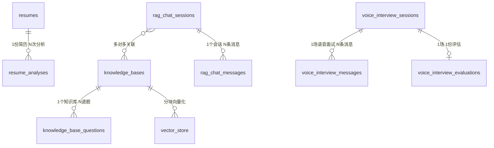

# 03 · 数据库拆解（AI PM 视角）

> **文档定位**：讲清「数据怎么组织、每个字段是什么含义」。这是 PM 读懂产品底层逻辑的关键——字段的中文含义，就是产品概念的落地。这份拆解基于开源代码的原始表结构（16 张表）梳理而来，按产品定位裁剪到 12 张核心表。
>
> **产品定位**：C 端求职者的 AI 面试陪练。数据表服务于简历分析、语音面试、定向备考、面试日程四大场景。

---

## 一、从 14 张到 12 张：砍表的决策证据

> **这是全文档最重要的一个数字，也是最能证明"产品判断"的一条证据。**

原系统共 **14 张表**，6 个业务域。其中有一块和「单一 C 端语音陪练」的定位不符：

- **文字面试域占 2 张**：`interview_sessions`（文字面试会话）、`interview_answers`（文字面试回答）——文字作答存在答案粘贴空间，无法还原真实面试的表达压力与临场反应。

产品定位收敛后，**砍掉文字面试**，这 2 张表随之消失，核心业务收敛为 **5 个域 12 张表**。

为什么砍表是**产品决策**而不是技术决策：

1. **砍功能不是删页面**——是数据模型、接口、评估链路的整体收缩。表是功能存在的证据，表没了，功能才真正消失。
2. **砍的取舍有用户价值依据**：文字刷题赛道已有成熟产品（牛客、力扣），语音对练才是差异化；而「填 Key 选模型」是技术用户 / B 端的需求，C 端要的是开箱即用。
3. **砍表是"做减法"策略在数据层的落地**：多端通用工具的问题是每类用户都服务不好，聚焦单一用户后，无关的域自然出局。

> **PM 要点**（脱口而出版）：「我把 14 张表砍到 12 张——砍的是文字面试域两张表（`interview_sessions`、`interview_answers`）。文字作答存在答案粘贴空间，无法还原真实面试压力，砍功能不是删页面，是数据模型、接口、评估链路的整体收缩。」

## 二、设计原则（PM 视角）

1. **业务数据存 PostgreSQL 关系表，向量单独存 `vector_store` 表**（HNSW 索引 + COSINE 距离，维度 **1024**）。
2. **长耗时任务的中间结果用 JSON 字段（TEXT）存**——LLM 输出结构不稳定，不强行拆表。
3. **文件内容不进库**，只存元信息 + `storage_key/storage_url` 指向 S3。
4. **状态机用 CHECK 约束兜底**——保证 `analyze_status` 等字段只能取合法值。

---

## 三、数据全景：12 张表按 5 个业务域分组

| 业务域 | 表 | 一句话含义 |
|---|---|---|
| ① 简历 | `resumes` / `resume_analyses` | 简历文件 + AI 分析结果 |
| ② 语音面试 | `voice_interview_sessions` / `voice_interview_messages` / `voice_interview_evaluations` | 语音会话 + 消息记录 + 评估结果 |
| ③ 知识库 | `knowledge_bases` / `knowledge_base_questions` / `vector_store` | 知识库文档 + 生成题目 + 向量块 |
| ④ RAG 问答 | `rag_chat_sessions` / `rag_chat_messages` | 聊天会话 + 消息（与语音面试完全独立） |
| ⑤ 面试安排 | `interview_schedule` | 面试日程记录 |

---

## 四、每张表字段中文含义（逐表逐字段）

### ① 简历域

#### `resumes` — 简历文件表

| 字段 | 中文含义 |
|---|---|
| `id` | 主键（自增） |
| `original_filename` | 原始文件名 |
| `file_hash` | 文件内容哈希（**去重唯一键**，相同内容只存一份） |
| `file_size` | 文件大小（字节） |
| `content_type` | 文件类型（如 application/pdf） |
| `resume_text` | 解析出的简历纯文本（AI 分析的数据源） |
| `storage_key` | 对象存储中的存储键 |
| `storage_url` | 对象存储访问 URL |
| `analyze_status` | 分析状态（PENDING 待分析 / PROCESSING 分析中 / COMPLETED 已完成 / FAILED 失败） |
| `analyze_error` | 分析失败原因 |
| `access_count` | 被访问次数 |
| `uploaded_at` | 上传时间 |
| `last_accessed_at` | 最近一次访问时间 |
| `analyze_updated_at` | 分析任务的最后进度时间（用于卡住任务恢复） |
| `analyze_recovery_count` | 分析任务恢复次数 |
| `analyze_attempt_id` | 分析执行代次 token（防旧消费者写脏数据） |

#### `resume_analyses` — 简历分析结果表

| 字段 | 中文含义 |
|---|---|
| `id` | 主键 |
| `resume_id` | 关联的简历 ID（外键 → resumes） |
| `analyzed_at` | 分析完成时间 |
| `overall_score` | 综合总分 |
| `content_score` | 内容维度得分 |
| `structure_score` | 结构维度得分 |
| `expression_score` | 表达维度得分 |
| `project_score` | 项目经历维度得分 |
| `skill_match_score` | 技能匹配度得分 |
| `strengths_json` | 优势（JSON 数组） |
| `suggestions_json` | 改进建议（JSON 数组） |
| `summary` | 简历综合评价摘要 |

### ② 语音面试域

#### `voice_interview_sessions` — 语音面试会话表

| 字段 | 中文含义 |
|---|---|
| `id` | 主键 |
| `role_type` | 面试角色类型（如 java-backend） |
| `skill_id` | 面试方向模板 ID |
| `difficulty` | 难度 |
| `custom_jd_text` | 自定义 JD 文本（JD 出题时使用） |
| `resume_id` | 关联简历 ID |
| `user_id` | 用户标识 |
| `current_phase` | 当前阶段（INTRO 自我介绍 / TECH 技术考察 / PROJECT 项目深挖 / HR 环节 / COMPLETED 完成） |
| `intro_enabled` | 是否启用自我介绍环节 |
| `tech_enabled` | 是否启用技术考察环节 |
| `project_enabled` | 是否启用项目深挖环节 |
| `hr_enabled` | 是否启用 HR 环节 |
| `planned_duration` | 计划时长（分钟） |
| `actual_duration` | 实际时长（分钟） |
| `status` | 会话状态（IN_PROGRESS / PAUSED 已暂停 / COMPLETED / FAILED） |
| `evaluate_status` | 评估状态（PENDING / PROCESSING / COMPLETED / FAILED） |
| `evaluate_error` | 评估失败原因 |
| `start_time` / `end_time` | 开始 / 结束时间 |
| `paused_at` / `resumed_at` | 暂停 / 恢复时间 |
| `created_at` / `updated_at` | 创建 / 更新时间 |

#### `voice_interview_messages` — 语音面试消息表

| 字段 | 中文含义 |
|---|---|
| `id` | 主键 |
| `session_id` | 关联语音会话 ID |
| `sequence_num` | 消息序号 |
| `message_type` | 消息类型 |
| `phase` | 所属阶段（INTRO/TECH/PROJECT/HR/COMPLETED） |
| `user_recognized_text` | 用户语音识别出的文本（ASR 结果） |
| `ai_generated_text` | AI 生成的文本 |
| `summary_covered_sequence_num` | 上下文摘要覆盖到的序号边界（仅 SUMMARY 行使用） |
| `timestamp` | 消息时间戳 |
| `created_at` | 创建时间 |

#### `voice_interview_evaluations` — 语音面试评估表

| 字段 | 中文含义 |
|---|---|
| `id` | 主键 |
| `session_id` | 关联语音会话 ID（唯一，1 场面试 1 份评估） |
| `interviewer_role` | 面试官角色 |
| `interview_date` | 面试日期 |
| `overall_score` | 总分 |
| `overall_feedback` | 总体反馈 |
| `strengths_json` | 优势（JSON） |
| `improvements_json` | 改进建议（JSON） |
| `question_evaluations_json` | 逐题评价（JSON） |
| `reference_answers_json` | 参考答案（JSON） |
| `created_at` | 创建时间 |

### ③ 知识库域

#### `knowledge_bases` — 知识库表

| 字段 | 中文含义 |
|---|---|
| `id` | 主键 |
| `name` | 知识库名称 |
| `original_filename` | 原始文件名 |
| `file_hash` | 文件内容哈希（去重唯一键） |
| `file_size` | 文件大小 |
| `content_type` | 文件类型 |
| `category` | 分类 |
| `storage_key` / `storage_url` | 对象存储键 / URL |
| `chunk_count` | 分块数量（向量化后切了多少块） |
| `question_count` | 已生成的题目数量 |
| `vector_status` | 向量化状态（PENDING / PROCESSING / COMPLETED / FAILED） |
| `vector_error` | 向量化失败原因 |
| `vector_config` | 向量化 Chunk 策略快照 |
| `vectorized_at` | 向量化完成时间 |
| `vector_updated_at` | 向量化最后进度时间（卡住任务恢复） |
| `vector_recovery_count` | 向量化恢复次数 |
| `vector_attempt_id` | 向量化执行代次 token（防旧消费者写脏数据） |
| `access_count` | 访问次数 |
| `uploaded_at` / `last_accessed_at` | 上传 / 最近访问时间 |

#### `knowledge_base_questions` — 知识库题目表

| 字段 | 中文含义 |
|---|---|
| `id` | 主键 |
| `knowledge_base_id` | 关联知识库 ID（外键） |
| `skill_id` | 面试方向 |
| `category` | 题目分类 |
| `difficulty` | 难度 |
| `type` | 题目类型 |
| `question` | 主问题内容 |
| `reference_answer` | 参考答案 |
| `key_points_json` | 关键点（JSON） |
| `scoring_rubric` | 评分标准 |
| `follow_ups_json` | 追问列表（JSON） |
| `source_context` | 题目来源的原文上下文 |
| `topic_summary` | 主题摘要 |
| `kb_content_hash` | 知识库内容哈希 |
| `status` | 题目状态（DRAFT 草稿 / ACTIVE 已启用 / ARCHIVED 已归档 / STALE 失效） |
| `created_at` / `updated_at` | 创建 / 更新时间 |

#### `vector_store` — 向量存储表

| 字段 | 中文含义 |
|---|---|
| `id` | 主键（UUID） |
| `content` | 向量块对应的文本内容 |
| `metadata` | 元数据（JSON，记录来源知识库、分块序号等信息） |
| `embedding` | 向量（1024 维，HNSW 索引 + COSINE 距离检索） |

### ④ RAG 问答域

#### `rag_chat_sessions` — RAG 聊天会话表

| 字段 | 中文含义 |
|---|---|
| `id` | 主键 |
| `title` | 会话标题 |
| `is_pinned` | 是否置顶 |
| `message_count` | 消息数量 |
| `status` | 状态（ACTIVE 活跃 / ARCHIVED 已归档） |
| `created_at` / `updated_at` | 创建 / 更新时间 |

#### `rag_chat_messages` — RAG 聊天消息表

| 字段 | 中文含义 |
|---|---|
| `id` | 主键 |
| `session_id` | 关联会话 ID（外键） |
| `message_order` | 消息顺序（第几条） |
| `type` | 消息类型（USER 用户 / ASSISTANT 助手） |
| `content` | 消息内容 |
| `completed` | 是否生成完成（流式输出的完成标记） |
| `created_at` / `updated_at` | 创建 / 更新时间 |

#### `rag_session_knowledge_bases` — 会话-知识库关联表

| 字段 | 中文含义 |
|---|---|
| `session_id` | 会话 ID（联合主键之一） |
| `knowledge_base_id` | 知识库 ID（联合主键之一，多对多关联） |

### ⑤ 面试安排域

#### `interview_schedule` — 面试日程表

| 字段 | 中文含义 |
|---|---|
| `id` | 主键 |
| `company_name` | 公司名称 |
| `position` | 岗位 |
| `interview_time` | 面试时间 |
| `interview_type` | 面试类型（如技术面、HR 面） |
| `round_number` | 面试轮次 |
| `interviewer` | 面试官 |
| `meeting_link` | 会议链接（飞书/腾讯会议/Zoom） |
| `notes` | 备注 |
| `status` | 状态（PENDING 待面试 / COMPLETED 已完成 / CANCELLED 已取消 / RESCHEDULED 已改期） |
| `created_at` / `updated_at` | 创建 / 更新时间 |

---

## 五、表关系（ER 图 + 文字说明）

### ER 图

### 文字版核心关系（兜底，怕 mermaid 渲染不出）

- `resumes` 1 — N `resume_analyses`（一份简历可多次分析）
- `knowledge_bases` 1 — N `knowledge_base_questions`（一个知识库多道题）
- `knowledge_bases` 1 — N `vector_store`（一个知识库多个向量块）
- `rag_chat_sessions` 1 — N `rag_chat_messages`（一个会话多条消息）
- `rag_chat_sessions` N — N `knowledge_bases`（通过 `rag_session_knowledge_bases` 关联）
- `voice_interview_sessions` 1 — N `voice_interview_messages`（一场语音面试多条消息）
- `voice_interview_sessions` 1 — 1 `voice_interview_evaluations`（一场一份评估）

---

## 六、三个值得 PM 注意的设计点

1. **异步状态机贯穿全文**：简历分析、向量化、出题、评估都是 `PENDING → PROCESSING → COMPLETED/FAILED`。这决定了前端必须有「进度 + 轮询」交互。

2. **JSON 字段 vs 拆表**：评估维度（`strengths_json`）、逐题评价（`question_evaluations_json`）、追问（`follow_ups_json`）都用 JSON 存。这是「LLM 输出结构不稳定 → 用 JSON 存，不强行建模」的务实选择。

3. **演进字段 = 产品迭代轨迹**（迁移脚本里的字段名就是产品踩过的坑）：
   - `vector_attempt_id` / `analyze_attempt_id` → 防旧消费者写脏数据（fencing token）
   - `vector_recovery_count` / `analyze_recovery_count` → 卡住任务自动恢复
   - `vector_config` → 记录向量化策略快照
   - `summary_covered_sequence_num` → 语音上下文摘要覆盖边界

   > 这些字段名本身就能读懂「产品遇到过什么问题、怎么解决的」。
